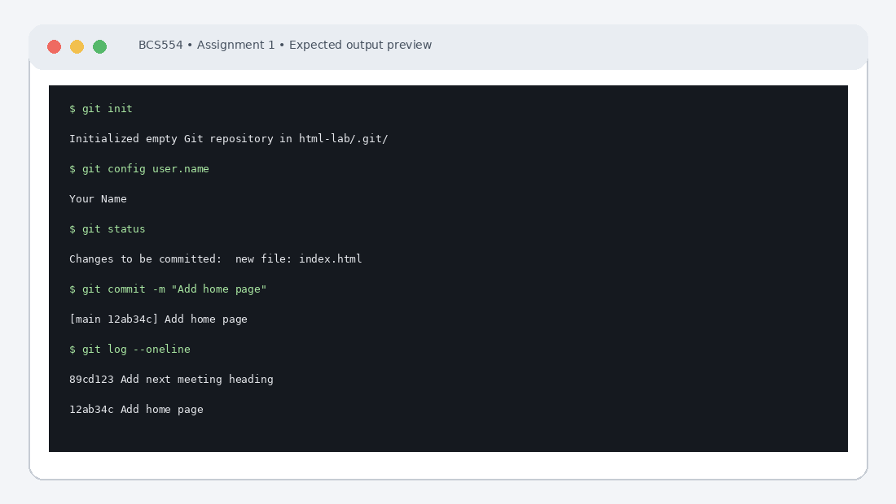

# Experiment No. 1: Starting a Git Repository

| Field | Detail |
| :--- | :--- |
| **Student Name** | Tanishk Jaiswal |
| **Roll Number** | 2410303504 |
| **Course / Branch** | B.Tech CSE – Third Year |
| **Subject** | BCS554 – HTML & CSS Development Lab |
| **Academic Session** | 2026–2027 |
| **Institution** | Invertis University, Bareilly |

---

## 1. Aim
Start a Git repository for your lab folder and save your work with commits.

---

## 2. Software / Tools Required
Computer/Laptop, Visual Studio Code or any text editor, web browser (Chrome/Edge/Firefox), HTML5, CSS3, Git and terminal/command prompt.

---

## 3. Theory
Git is a distributed version-control system. A repository stores project files and their history. The working directory contains files being edited, the staging area holds changes selected for the next commit, and a commit records a snapshot with a message.

---

## 4. Algorithm / Procedure
1. Create a folder named html-lab and run git init. Set your own name and email using git config --local, then display both values.
2. Create index.html with one h1 heading. Run git status, stage the file and commit it with the exact message Add home page.
3. Add an h2 heading below the h1, commit with the exact message Add next meeting heading, then run git log --oneline.

---

## 5. Program / Queries / Commands

### Task 1 – Initialize repository and set local identity
```bash
mkdir html-lab
cd html-lab
git init
git config --local user.name "Tanishk Jaiswal"
git config --local user.email "jtanishk121@gmail.com"
git config user.name
git config user.email
```

### Task 2 – Create and commit index.html
```bash
echo "<h1>Welcome to HTML Lab</h1>" > index.html
git status
git add index.html
git commit -m "Add home page"
```

### Task 3 – Add second heading and view history
```bash
echo "<h2>Next Meeting</h2>" >> index.html
git add index.html
git commit -m "Add next meeting heading"
git log --oneline
```

---

## 6. Input
Use the sample text and values specified in the tasks above. For personal details and image filenames, substitute your own values or the instructor-provided filename.

---

## 7. Output Description
Terminal output: each git config command prints the value set; git status shows index.html as untracked before staging; the first commit reports one file changed; git log shows two commits with the newest first.

---

## 8. Output Screenshot


---

## 9. Result
The experiment was completed according to the stated aim. Terminal output: each git config command prints the value set; git status shows index.html as untracked before staging; the first commit reports one file changed; git log shows two commits with the newest first.

---

## 10. Viva-Voce Questions & Answers
**Q: What is Git?**

> **Answer:** Git is a distributed version-control system designed to track changes in source code during software development, allowing multiple developers to coordinate work, branch, merge, and maintain full project history.

**Q: Differentiate git add and git commit.**

> **Answer:** `git add` moves changes from the working directory to the staging area (index) preparing them for inclusion in the next snapshot, whereas `git commit` permanently saves staged changes to the repository history with an associated commit message.

**Q: What does git status display?**

> **Answer:** `git status` displays the current state of the working directory and staging area: showing tracked, modified, staged, and untracked files, as well as the active branch.

**Q: What is the purpose of git log --oneline?**

> **Answer:** `git log --oneline` prints a condensed, single-line summary of commit history showing the abbreviated commit hash and the first line of the commit message for quick readability.

