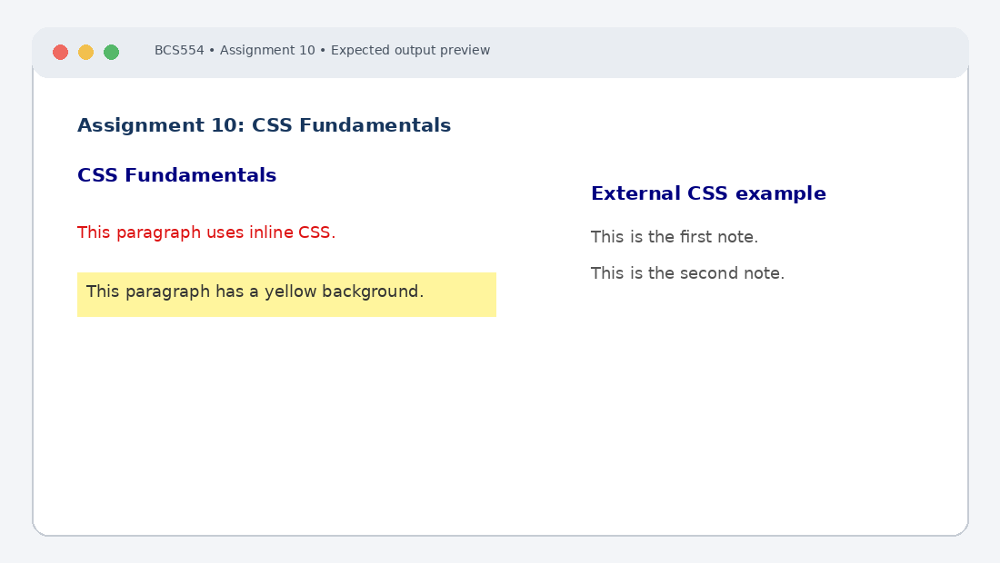

# Experiment No. 10: CSS Fundamentals

| Field | Detail |
| :--- | :--- |
| **Student Name** | Tanishk Jaiswal |
| **Roll Number** | 2410303504 |
| **Course / Branch** | B.Tech CSE – Third Year |
| **Subject** | BCS554 – HTML & CSS Development Lab |
| **Academic Session** | 2026–2027 |
| **Institution** | Invertis University, Bareilly |

---

## 1. Aim
Apply CSS in three ways (inline, internal and linked) and use selectors and text styles.

---

## 2. Software / Tools Required
Computer/Laptop, Visual Studio Code or any text editor, web browser (Chrome/Edge/Firefox), HTML5, CSS3.

---

## 3. Theory
CSS (Cascading Style Sheets) controls the presentation of HTML. Inline CSS is written in an element's style attribute, internal CSS is written in a style element, and external CSS is stored in a separate file linked with link. Selectors target elements, classes and IDs.

---

## 4. Algorithm / Procedure
1. Create inline-internal.html with internal rules making h1 navy and .highlight yellow. Add a red inline-styled paragraph and a highlighted paragraph.
2. Create style.css with h1 navy, .note italic, #title underlined and p text 18px grey.
3. Create linked.html linking style.css, with an h1 id title and two paragraphs class note.

---

## 5. Program / Queries / Commands

### Task 1 – inline-internal.html
```html
<!DOCTYPE html>
<html lang="en">
<head>
 <meta charset="UTF-8"><title>CSS Methods</title>
 <style>
 h1 { color: navy; }
 .highlight { background-color: yellow; }
 </style>
</head>
<body>
 <h1>CSS Fundamentals</h1>
 <p style="color: red;">This paragraph uses inline CSS.</p>
 <p class="highlight">This paragraph has a yellow background.</p>
</body>
</html>
```

### Task 2 – style.css
```css
h1 { color: navy; }
.note { font-style: italic; }
#title { text-decoration: underline; }
p { font-size: 18px; color: grey; }
```

### Task 3 – linked.html
```html
<!DOCTYPE html>
<html lang="en">
<head>
 <meta charset="UTF-8"><title>Linked CSS</title>
 <link rel="stylesheet" href="style.css">
</head>
<body>
 <h1 id="title">External CSS Example</h1>
 <p class="note">This is the first note.</p>
 <p class="note">This is the second note.</p>
</body>
</html>
```

---

## 6. Input
Use the sample text and values specified in the tasks above. For personal details and image filenames, substitute your own values or the instructor-provided filename.

---

## 7. Output Description
Browser output: navy heading, red inline paragraph and yellow highlighted paragraph. In linked.html, styles apply when style.css is saved in the same folder; notes are italic and the title is underlined.

---

## 8. Output Screenshot


---

## 9. Result
The experiment was completed according to the stated aim. Browser output: navy heading, red inline paragraph and yellow highlighted paragraph. In linked.html, styles apply when style.css is saved in the same folder; notes are italic and the title is underlined.

---

## 10. Viva-Voce Questions & Answers
**Q: What is CSS?**

> **Answer:** Cascading Style Sheets (CSS) is a stylesheet language used to specify the layout, colors, typography, and visual presentation of documents written in HTML.

**Q: Name the three ways to add CSS.**

> **Answer:** 1. Inline CSS (using the `style` attribute on HTML elements)
2. Internal CSS (using the `<style>` tag within the `<head>`)
3. External CSS (linking an external `.css` file via `<link rel="stylesheet" href="...">`).

**Q: What is a CSS selector?**

> **Answer:** A CSS selector is a pattern used to select the HTML elements you want to style (e.g. element selectors, class selectors, ID selectors, and attribute selectors).

**Q: Differentiate class and ID selectors.**

> **Answer:** A class selector (`.classname`) can target multiple elements across a page and has lower specificity. An ID selector (`#idname`) targets a single unique element and has higher specificity.

