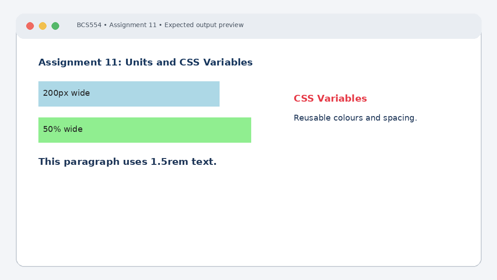

# Experiment No. 11: Units and CSS Variables

| Field | Detail |
| :--- | :--- |
| **Student Name** | Tanishk Jaiswal |
| **Roll Number** | 2410303504 |
| **Course / Branch** | B.Tech CSE – Third Year |
| **Subject** | BCS554 – HTML & CSS Development Lab |
| **Academic Session** | 2026–2027 |
| **Institution** | Invertis University, Bareilly |

---

## 1. Aim
Use CSS units and store colours and spacing in variables.

---

## 2. Software / Tools Required
Computer/Laptop, Visual Studio Code or any text editor, web browser (Chrome/Edge/Firefox), HTML5, CSS3.

---

## 3. Theory
CSS units include absolute units such as px and relative units such as %, rem and em. rem is relative to the root element's font size. CSS custom properties are declared with a -- prefix and accessed using var().

---

## 4. Algorithm / Procedure
1. Create units.html with a 200px × 40px box, a 50% × 40px box and a paragraph at 1.5rem. Give both boxes background colours.
2. Create variables.html with :root variables --main-color #1d3557, --accent-color #e63946 and --page-padding 20px. Use var() for body colour/padding and h1 colour.
3. Create tokens.css with --primary-color #1d3557, --accent-color #e63946, --heading-size 2rem and --spacing 16px. Use the variables for body and h1 styles.

---

## 5. Program / Queries / Commands

### Task 1 – units.html
```html
<!DOCTYPE html>
<html lang="en">
<head><meta charset="UTF-8"><title>CSS Units</title>
<style>
 .box-px { width: 200px; height: 40px; background: lightblue; }
 .box-percent { width: 50%; height: 40px; background: lightgreen; }
 p { font-size: 1.5rem; }
</style></head>
<body>
 <div class="box-px">200px wide</div>
 <div class="box-percent">50% wide</div>
 <p>This paragraph uses 1.5rem text.</p>
</body>
</html>
```

### Task 2 – variables.html
```html
<!DOCTYPE html>
<html lang="en">
<head><meta charset="UTF-8"><title>CSS Variables</title>
<style>
:root {
 --main-color: #1d3557;
 --accent-color: #e63946;
 --page-padding: 20px;
}
body { color: var(--main-color); padding: var(--page-padding); }
h1 { color: var(--accent-color); }
</style></head>
<body>
 <h1>CSS Variables</h1>
 <p>Reusable colours and spacing make styling consistent.</p>
</body>
</html>
```

### Task 3 – tokens.css
```css
:root {
 --primary-color: #1d3557;
 --accent-color: #e63946;
 --heading-size: 2rem;
 --spacing: 16px;
}
body { color: var(--primary-color); padding: var(--spacing); }
h1 { color: var(--accent-color); font-size: var(--heading-size); }
```

---

## 6. Input
Use the sample text and values specified in the tasks above. For personal details and image filenames, substitute your own values or the instructor-provided filename.

---

## 7. Output Description
Browser output: a fixed 200px box, a half-width box and larger text appear. The variable-based page uses the accent colour for the heading and the main colour for text. tokens.css applies the specified heading size and spacing when linked.

---

## 8. Output Screenshot


---

## 9. Result
The experiment was completed according to the stated aim. Browser output: a fixed 200px box, a half-width box and larger text appear. The variable-based page uses the accent colour for the heading and the main colour for text. tokens.css applies the specified heading size and spacing when linked.

---

## 10. Viva-Voce Questions & Answers
**Q: What is the difference between px and %?**

> **Answer:** `px` (pixels) is an absolute unit representing a fixed physical screen size, whereas `%` is a relative unit calculated as a percentage of the parent container's dimensions.

**Q: What does rem depend on?**

> **Answer:** `rem` (root em) depends on the font-size of the root element (`<html>`), which defaults to `16px` in most browsers.

**Q: How do you declare a CSS variable?**

> **Answer:** CSS custom properties (variables) are declared inside a selector (typically `:root` for global scope) with two leading hyphens: `--variable-name: value;`.

**Q: How is var() used?**

> **Answer:** `var(--variable-name, fallback)` is a CSS functional notation used to retrieve and apply the value of a defined custom property.

