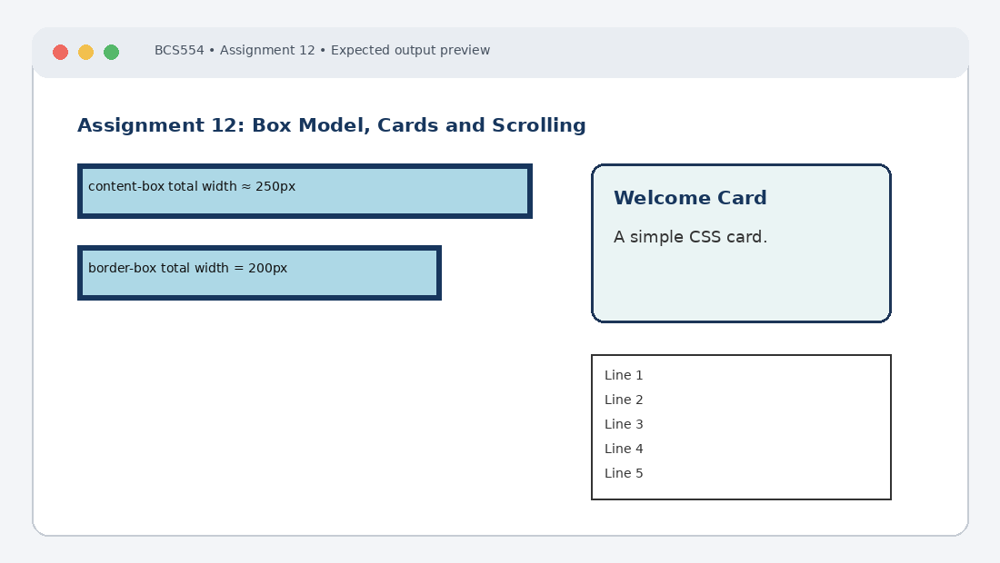

# Experiment No. 12: Box Model, Cards and Scrolling

| Field | Detail |
| :--- | :--- |
| **Student Name** | Tanishk Jaiswal |
| **Roll Number** | 2410303504 |
| **Course / Branch** | B.Tech CSE – Third Year |
| **Subject** | BCS554 – HTML & CSS Development Lab |
| **Academic Session** | 2026–2027 |
| **Institution** | Invertis University, Bareilly |

---

## 1. Aim
Compare the box sizing types, style a card and make a box scroll.

---

## 2. Software / Tools Required
Computer/Laptop, Visual Studio Code or any text editor, web browser (Chrome/Edge/Firefox), HTML5, CSS3.

---

## 3. Theory
The CSS box model consists of content, padding, border and margin. With content-box, the declared width applies to content only; padding and border increase total width. With border-box, the declared width includes content, padding and border. overflow controls content exceeding a container.

---

## 4. Algorithm / Procedure
1. Create box-model.html with two div boxes each width 200px, padding 20px and border 5px. Set the first to content-box and the second to border-box.
2. Create card.html with a .card div, background colour, 2px border, 12px rounded corners and 16px padding. Include h3 and paragraph.
3. Create scroll.html with a 120px-high div, overflow:auto and five paragraphs from Line 1 to Line 5.

---

## 5. Program / Queries / Commands

### Task 1 – box-model.html
```html
<!DOCTYPE html>
<html lang="en">
<head><meta charset="UTF-8"><title>Box Model</title>
<style>
.box { width: 200px; padding: 20px; border: 5px solid navy;
 margin: 15px; background: lightblue; }
.content { box-sizing: content-box; }
.border { box-sizing: border-box; }
</style></head>
<body>
 <div class="box content">content-box</div>
 <div class="box border">border-box</div>
</body>
</html>
```

### Task 2 – card.html
```html
<!DOCTYPE html>
<html lang="en">
<head><meta charset="UTF-8"><title>Card</title>
<style>
.card { background: #eaf4f4; border: 2px solid #1d3557;
 border-radius: 12px; padding: 16px; max-width: 320px; }
</style></head>
<body>
 <div class="card">
 <h3>Welcome Card</h3>
 <p>This is a simple card created using the CSS box model.</p>
 </div>
</body>
</html>
```

### Task 3 – scroll.html
```html
<!DOCTYPE html>
<html lang="en">
<head><meta charset="UTF-8"><title>Scrolling Box</title>
<style>
.scroll-box { height: 120px; overflow: auto;
 border: 1px solid black; padding: 8px; }
</style></head>
<body>
 <div class="scroll-box">
 <p>Line 1</p><p>Line 2</p><p>Line 3</p>
 <p>Line 4</p><p>Line 5</p>
 </div>
</body>
</html>
```

---

## 6. Input
Use the sample text and values specified in the tasks above. For personal details and image filenames, substitute your own values or the instructor-provided filename.

---

## 7. Output Description
Browser output: the content-box element has a larger total rendered width than the border-box element. The card has a coloured background and rounded corners. The five-line box can be scrolled.

---

## 8. Output Screenshot


---

## 9. Result
The experiment was completed according to the stated aim. Browser output: the content-box element has a larger total rendered width than the border-box element. The card has a coloured background and rounded corners. The five-line box can be scrolled.

---

## 10. Viva-Voce Questions & Answers
**Q: Name the four parts of the CSS box model.**

> **Answer:** The four concentric areas of the CSS box model from inside out are: Content, Padding, Border, and Margin.

**Q: How does border-box differ from content-box?**

> **Answer:** In `content-box` (the default), width and height apply only to the content area, so adding padding and border increases the total element width. In `border-box`, width and height encompass content, padding, and border.

**Q: What does overflow:auto do?**

> **Answer:** `overflow: auto` displays scrollbars only when the content inside an element overflows its container boundary, keeping the layout contained.

**Q: What is border-radius?**

> **Answer:** `border-radius` is a CSS property that rounds the outer corners of an element's border box.

