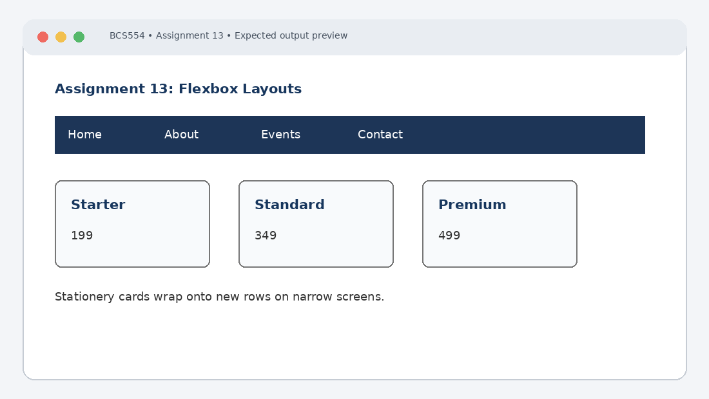

# Experiment No. 13: Flexbox Layouts

| Field | Detail |
| :--- | :--- |
| **Student Name** | Tanishk Jaiswal |
| **Roll Number** | 2410303504 |
| **Course / Branch** | B.Tech CSE – Third Year |
| **Subject** | BCS554 – HTML & CSS Development Lab |
| **Academic Session** | 2026–2027 |
| **Institution** | Invertis University, Bareilly |

---

## 1. Aim
Lay out a navigation bar, centred cards and cards that wrap, using Flexbox.

---

## 2. Software / Tools Required
Computer/Laptop, Visual Studio Code or any text editor, web browser (Chrome/Edge/Firefox), HTML5, CSS3.

---

## 3. Theory
Flexbox is a one-dimensional CSS layout model for arranging items in a row or column. display:flex creates a flex container. justify-content aligns items along the main axis, align-items along the cross axis, and flex-wrap allows items to move onto additional lines.

---

## 4. Algorithm / Procedure
1. Create nav-flex.html with a nav bar containing Home, About, Events and Contact. Use display:flex, a dark background and white link text.
2. Create centred-cards.html with Starter (199), Standard (349) and Premium (499) cards in one row. Use justify-content and align-items to centre them.
3. Create wrapping-cards.html with Notebook (60), Pen (15), Bag (350) and Book (120) in a flex-wrap row. Narrow the browser to test wrapping.

---

## 5. Program / Queries / Commands

### Task 1 – nav-flex.html
```html
<!DOCTYPE html>
<html lang="en">
<head><meta charset="UTF-8"><title>Flex Navigation</title>
<style>
nav { display: flex; gap: 24px; background: #1d3557; padding: 16px; }
nav a { color: white; text-decoration: none; }
</style></head>
<body>
 <nav><a href="#home">Home</a><a href="#about">About</a>
 <a href="#events">Events</a><a href="#contact">Contact</a></nav>
</body>
</html>
```

### Task 2 – centred-cards.html
```html
<!DOCTYPE html>
<html lang="en">
<head><meta charset="UTF-8"><title>Centred Cards</title>
<style>
.row { display: flex; justify-content: center; align-items: center;
 gap: 20px; min-height: 250px; }
.card { padding: 20px; border: 1px solid #777; border-radius: 8px;
 width: 150px; text-align: center; }
</style></head>
<body>
 <div class="row">
 <div class="card"><h3>Starter</h3><p>199</p></div>
 <div class="card"><h3>Standard</h3><p>349</p></div>
 <div class="card"><h3>Premium</h3><p>499</p></div>
 </div>
</body>
</html>
```

### Task 3 – wrapping-cards.html
```html
<!DOCTYPE html>
<html lang="en">
<head><meta charset="UTF-8"><title>Stationery Shop</title>
<style>
.cards { display: flex; flex-wrap: wrap; gap: 16px; }
.card { flex: 1 1 160px; padding: 20px; border: 1px solid #777;
 border-radius: 8px; }
</style></head>
<body>
 <h1>Stationery Shop</h1>
 <div class="cards">
 <div class="card"><h3>Notebook</h3><p>60</p></div>
 <div class="card"><h3>Pen</h3><p>15</p></div>
 <div class="card"><h3>Bag</h3><p>350</p></div>
 <div class="card"><h3>Book</h3><p>120</p></div>
 </div>
</body>
</html>
```

---

## 6. Input
Use the sample text and values specified in the tasks above. For personal details and image filenames, substitute your own values or the instructor-provided filename.

---

## 7. Output Description
Browser output: four white links appear side by side on a dark bar. Three pricing cards are centred in one row. Stationery cards wrap onto additional rows in a narrow window.

---

## 8. Output Screenshot


---

## 9. Result
The experiment was completed according to the stated aim. Browser output: four white links appear side by side on a dark bar. Three pricing cards are centred in one row. Stationery cards wrap onto additional rows in a narrow window.

---

## 10. Viva-Voce Questions & Answers
**Q: What is Flexbox?**

> **Answer:** Flexbox (CSS Flexible Box Layout) is a one-dimensional layout module designed for distributing space along a single axis (row or column) with dynamic sizing of child elements.

**Q: What does display:flex do?**

> **Answer:** `display: flex` converts an element into a flex container and transforms all its direct children into flexible items.

**Q: Differentiate justify-content and align-items.**

> **Answer:** `justify-content` defines alignment of flex items along the main axis (horizontal by default), while `align-items` defines alignment along the cross axis (vertical by default).

**Q: What is the use of flex-wrap?**

> **Answer:** `flex-wrap` allows flex items to wrap onto multiple lines when there is insufficient space in the container, instead of forcing them all onto a single overflowing line.

