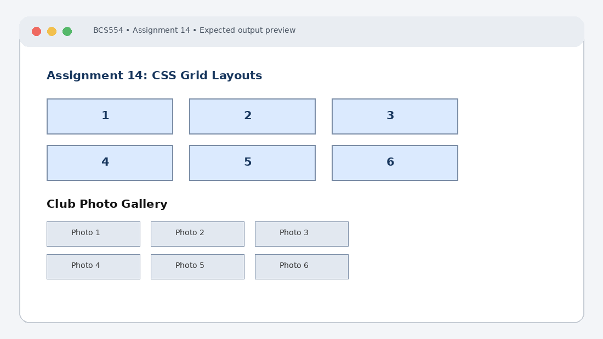

# Experiment No. 14: CSS Grid Layouts

| Field | Detail |
| :--- | :--- |
| **Student Name** | Tanishk Jaiswal |
| **Roll Number** | 2410303504 |
| **Course / Branch** | B.Tech CSE – Third Year |
| **Subject** | BCS554 – HTML & CSS Development Lab |
| **Academic Session** | 2026–2027 |
| **Institution** | Invertis University, Bareilly |

---

## 1. Aim
Make a grid with equal columns, a responsive gallery and a layout with named areas.

---

## 2. Software / Tools Required
Computer/Laptop, Visual Studio Code or any text editor, web browser (Chrome/Edge/Firefox), HTML5, CSS3.

---

## 3. Theory
CSS Grid is a two-dimensional layout system for rows and columns. display:grid creates a grid container. The fr unit distributes available space, repeat() repeats track definitions, minmax() sets a size range, and grid-template-areas names layout regions.

---

## 4. Algorithm / Procedure
1. Create grid-first.html with six numbered boxes in three equal fr columns and a 12px gap.
2. Create gallery.html with heading Club Photo Gallery and six boxes Photo 1 to Photo 6. Use repeat(auto-fill, minmax(150px, 1fr)) and 10px gap.
3. Create dashboard-areas.html with columns 200px and 1fr. Use grid-template-areas to place header and footer across both columns, sidebar left and main right.

---

## 5. Program / Queries / Commands

### Task 1 – grid-first.html
```html
<!DOCTYPE html>
<html lang="en">
<head><meta charset="UTF-8"><title>First Grid</title>
<style>
.grid { display: grid; grid-template-columns: repeat(3, 1fr); gap: 12px; }
.grid div { background: #dbeafe; padding: 24px; text-align: center; }
</style></head>
<body>
 <div class="grid"><div>1</div><div>2</div><div>3</div>
 <div>4</div><div>5</div><div>6</div></div>
</body>
</html>
```

### Task 2 – gallery.html
```html
<!DOCTYPE html>
<html lang="en">
<head><meta charset="UTF-8"><title>Club Photo Gallery</title>
<style>
.gallery { display: grid;
 grid-template-columns: repeat(auto-fill, minmax(150px, 1fr));
 gap: 10px; }
.gallery div { background: #e2e8f0; padding: 40px 10px; text-align: center; }
</style></head>
<body>
 <h1>Club Photo Gallery</h1>
 <div class="gallery">
 <div>Photo 1</div><div>Photo 2</div><div>Photo 3</div>
 <div>Photo 4</div><div>Photo 5</div><div>Photo 6</div>
 </div>
</body>
</html>
```

### Task 3 – dashboard-areas.html
```html
<!DOCTYPE html>
<html lang="en">
<head><meta charset="UTF-8"><title>Dashboard</title>
<style>
.dashboard { display: grid; grid-template-columns: 200px 1fr;
 grid-template-areas: "header header" "sidebar main" "footer footer";
 gap: 10px; }
.header { grid-area: header; } .sidebar { grid-area: sidebar; }
.main { grid-area: main; } .footer { grid-area: footer; }
.dashboard div { background: #dbeafe; padding: 20px; }
</style></head>
<body>
 <div class="dashboard">
 <div class="header">Header</div><div class="sidebar">Sidebar</div>
 <div class="main">Main Area</div><div class="footer">Footer</div>
 </div>
</body>
</html>
```

---

## 6. Input
Use the sample text and values specified in the tasks above. For personal details and image filenames, substitute your own values or the instructor-provided filename.

---

## 7. Output Description
Browser output: six boxes appear in two rows of three. The gallery fits more columns as the window widens. The dashboard has a full-width header and footer, sidebar left and main content right.

---

## 8. Output Screenshot


---

## 9. Result
The experiment was completed according to the stated aim. Browser output: six boxes appear in two rows of three. The gallery fits more columns as the window widens. The dashboard has a full-width header and footer, sidebar left and main content right.

---

## 10. Viva-Voce Questions & Answers
**Q: What is CSS Grid?**

> **Answer:** CSS Grid Layout is a powerful two-dimensional layout system for the web that handles both columns and rows simultaneously, allowing complex responsive page designs.

**Q: What does the fr unit represent?**

> **Answer:** The `fr` (fractional) unit represents a fraction of the available free space in the grid container.

**Q: What is the purpose of minmax()?**

> **Answer:** The `minmax(min, max)` functional notation defines a size range greater than or equal to `min` and less than or equal to `max`, enabling responsive track sizing.

**Q: How does grid-template-areas work?**

> **Answer:** `grid-template-areas` defines named grid areas by referencing string literals representing grid cells, allowing intuitive visual layout mapping in CSS.

