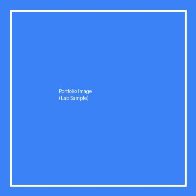
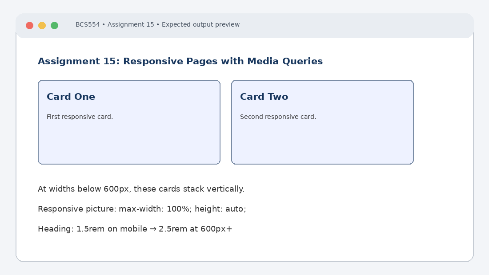

# Experiment No. 15: Responsive Pages with Media Queries

| Field | Detail |
| :--- | :--- |
| **Student Name** | Tanishk Jaiswal |
| **Roll Number** | 2410303504 |
| **Course / Branch** | B.Tech CSE – Third Year |
| **Subject** | BCS554 – HTML & CSS Development Lab |
| **Academic Session** | 2026–2027 |
| **Institution** | Invertis University, Bareilly |

---

## 1. Aim
Use a media query to change a layout, make a picture scale with its box, and set text sizes with rem units.

---

## 2. Software / Tools Required
Computer/Laptop, Visual Studio Code or any text editor, web browser (Chrome/Edge/Firefox), HTML5, CSS3.

---

## 3. Theory
Responsive web design allows a page to adapt to different screen sizes. The viewport meta tag helps mobile browsers use the device width. Media queries apply CSS when conditions such as a minimum viewport width are met. max-width:100% and height:auto let an image scale while preserving its aspect ratio.

---

## 4. Algorithm / Procedure
1. Create mobile-first.html with viewport meta tag and two cards. Stack them on phones; at 600px and wider, show them side by side.
2. Create responsive-image.html with a heading and an image from images folder. Use max-width:100% and height:auto. Replace the image filename with the one supplied by your instructor.
3. Create responsive-text.html with body font size 1rem and h1 size 1.5rem. At 600px and wider, set h1 to 2.5rem.

---

## 5. Program / Queries / Commands

### Task 1 – mobile-first.html
```html
<!DOCTYPE html>
<html lang="en">
<head>
 <meta charset="UTF-8">
 <meta name="viewport" content="width=device-width, initial-scale=1.0">
 <title>Mobile First</title>
 <style>
 .cards { display: flex; flex-direction: column; gap: 16px; }
 .card { padding: 20px; border: 1px solid #777; }
 @media (min-width: 600px) {
 .cards { flex-direction: row; }
 .card { flex: 1; }
 }
 </style>
</head>
<body>
 <div class="cards">
 <div class="card"><h2>Card One</h2><p>First responsive card.</p></div>
 <div class="card"><h2>Card Two</h2><p>Second responsive card.</p></div>
 </div>
</body>
</html>
```

### Task 2 – responsive-image.html
```html
<!DOCTYPE html>
<html lang="en">
<head>
 <meta charset="UTF-8">
 <meta name="viewport" content="width=device-width, initial-scale=1.0">
 <title>Responsive Image</title>
 <style>img { max-width: 100%; height: auto; }</style>
</head>
<body>
 <h1>Responsive Picture</h1>
 
</body>
</html>
```

### Task 3 – responsive-text.html
```html
<!DOCTYPE html>
<html lang="en">
<head>
 <meta charset="UTF-8">
 <meta name="viewport" content="width=device-width, initial-scale=1.0">
 <title>Responsive Text</title>
 <style>
 body { font-size: 1rem; }
 h1 { font-size: 1.5rem; }
 @media (min-width: 600px) { h1 { font-size: 2.5rem; } }
 </style>
</head>
<body>
 <h1>Responsive Heading</h1>
 <p>This text remains readable on different screen sizes.</p>
</body>
</html>
```

---

## 6. Input
Use the sample text and values specified in the tasks above. For personal details and image filenames, substitute your own values or the instructor-provided filename.

---

## 7. Output Description
Browser output: on a phone, two cards stack; at 600px and above, they appear side by side. The picture shrinks to fit a narrow window. The heading is larger at widths of 600px or more.

---

## 8. Output Screenshot


---

## 9. Result
The experiment was completed according to the stated aim. Browser output: on a phone, two cards stack; at 600px and above, they appear side by side. The picture shrinks to fit a narrow window. The heading is larger at widths of 600px or more.

---

## 10. Viva-Voce Questions & Answers
**Q: What is responsive web design?**

> **Answer:** Responsive web design is an approach to web design that aims to make web pages render well and provide an optimal user experience across a variety of devices, screen sizes, and orientations.

**Q: Why is the viewport meta tag used?**

> **Answer:** `<meta name="viewport" content="width=device-width, initial-scale=1.0">` ensures mobile browsers set the layout width to the actual physical screen width rather than defaulting to a zoomed-out 980px desktop viewport.

**Q: What is a media query?**

> **Answer:** A media query is a CSS technique that applies specific style blocks only when specified media conditions (such as viewport width, height, or orientation) evaluate to true.

**Q: Why are max-width:100% and height:auto used for images?**

> **Answer:** `max-width: 100%` ensures that an image scales down dynamically to fit within its parent container without exceeding it, while `height: auto` maintains the image's original aspect ratio without distortion.

