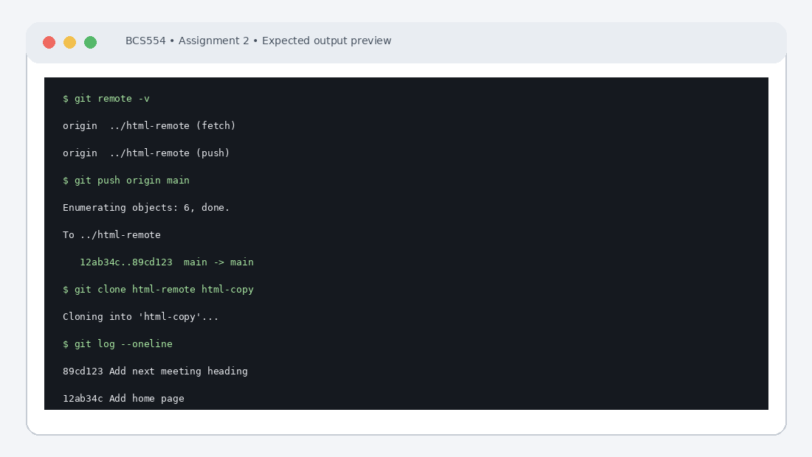

# Experiment No. 2: Pushing and Cloning a Repository

| Field | Detail |
| :--- | :--- |
| **Student Name** | Tanishk Jaiswal |
| **Roll Number** | 2410303504 |
| **Course / Branch** | B.Tech CSE – Third Year |
| **Subject** | BCS554 – HTML & CSS Development Lab |
| **Academic Session** | 2026–2027 |
| **Institution** | Invertis University, Bareilly |

---

## 1. Aim
Send your commits to a second repository on your computer and make a copy of it with clone.

---

## 2. Software / Tools Required
Computer/Laptop, Visual Studio Code or any text editor, web browser (Chrome/Edge/Firefox), HTML5, CSS3, Git and terminal/command prompt.

---

## 3. Theory
A remote repository is another Git repository used to exchange changes. A bare repository has no working checkout and is commonly used as a central remote. The clone command creates a local copy including repository history.

---

## 4. Algorithm / Procedure
1. From inside html-lab, create the bare repository ../html-remote, add it as origin and run git remote -v.
2. Push commits using git push origin main. If your branch is master, push master instead.
3. Go up one folder, clone html-remote into html-copy, enter that folder and display the commit history.

---

## 5. Program / Queries / Commands

### Task 1 – Create a bare remote and add origin
```bash
git init --bare ../html-remote
git remote add origin ../html-remote
git remote -v
```

### Task 2 – Push commits
```bash
git push origin main
# If your current branch is master, use:
git push origin master
```

### Task 3 – Clone the remote repository
```bash
cd ..
git clone html-remote html-copy
cd html-copy
git log --oneline
```

---

## 6. Input
Use the sample text and values specified in the tasks above. For personal details and image filenames, substitute your own values or the instructor-provided filename.

---

## 7. Output Description
Terminal output: origin is listed for fetch and push; push ends with a branch update such as main -> main; the cloned repository shows the same commits.

---

## 8. Output Screenshot


---

## 9. Result
The experiment was completed according to the stated aim. Terminal output: origin is listed for fetch and push; push ends with a branch update such as main -> main; the cloned repository shows the same commits.

---

## 10. Viva-Voce Questions & Answers
**Q: What is a remote repository?**

> **Answer:** A remote repository is a version of your project that is hosted on an external server, network, or another directory on your machine, enabling collaboration and safe off-site synchronization of branches.

**Q: What is a bare repository?**

> **Answer:** A bare repository is a Git repository created without a working directory (i.e. contains only the contents of the .git directory). It is used purely as a central storage node to push to and fetch/clone from.

**Q: What is the use of origin?**

> **Answer:** `origin` is the default shorthand alias name given to the remote repository URL from which a project was cloned or to which commits are pushed.

**Q: Differentiate git clone and git pull.**

> **Answer:** `git clone` initializes a brand new local repository by copying all branches and historical commits from a remote repository. `git pull` fetches updates from an existing remote branch and merges them into the current active local branch.

