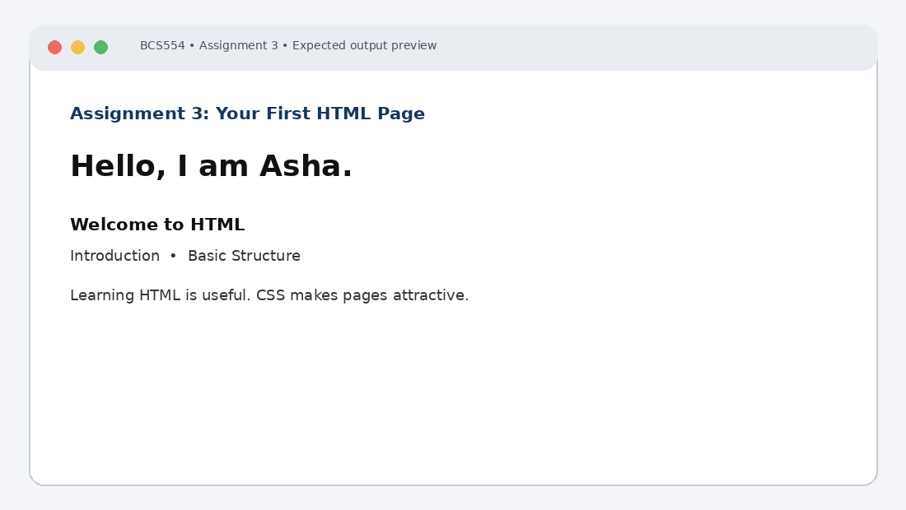

# Experiment No. 3: Your First HTML Page

| Field | Detail |
| :--- | :--- |
| **Student Name** | Tanishk Jaiswal |
| **Roll Number** | 2410303504 |
| **Course / Branch** | B.Tech CSE – Third Year |
| **Subject** | BCS554 – HTML & CSS Development Lab |
| **Academic Session** | 2026–2027 |
| **Institution** | Invertis University, Bareilly |

---

## 1. Aim
Write a first HTML page with a title, headings and a paragraph, and format some text.

---

## 2. Software / Tools Required
Computer/Laptop, Visual Studio Code or any text editor, web browser (Chrome/Edge/Firefox), HTML5, CSS3.

---

## 3. Theory
HTML (HyperText Markup Language) defines the structure of a web page. A basic document contains doctype, html, head and body elements. Heading elements range from h1 to h6; p creates a paragraph, strong gives strong importance and em gives emphasis.

---

## 4. Algorithm / Procedure
1. Create first.html with the title My First Page and h1 text Hello, I am Asha. Open it in a browser.
2. Create headings.html with h1, h2, h3 and one paragraph.
3. Create text-format.html with two paragraphs; use strong and em on one word each and include a line break inside a paragraph.

---

## 5. Program / Queries / Commands

### Task 1 – first.html
```html
<!DOCTYPE html>
<html lang="en">
<head>
 <meta charset="UTF-8">
 <title>My First Page</title>
</head>
<body>
 <h1>Hello, I am Asha.</h1>
</body>
</html>
```

### Task 2 – headings.html
```html
<!DOCTYPE html>
<html lang="en">
<head><meta charset="UTF-8"><title>Headings</title></head>
<body>
 <h1>Welcome to HTML</h1>
 <h2>Introduction</h2>
 <h3>Basic Structure</h3>
 <p>HTML is used to structure web pages.</p>
</body>
</html>
```

### Task 3 – text-format.html
```html
<!DOCTYPE html>
<html lang="en">
<head><meta charset="UTF-8"><title>Text Formatting</title></head>
<body>
 <p>Learning <strong>HTML</strong> is useful.<br>
 It builds web page structure.</p>
 <p>CSS makes pages <em>attractive</em> and readable.</p>
</body>
</html>
```

---

## 6. Input
Use the sample text and values specified in the tasks above. For personal details and image filenames, substitute your own values or the instructor-provided filename.

---

## 7. Output Description
Browser output: the first tab title is My First Page and the page shows one large heading. The second page shows three decreasing heading sizes and a paragraph. In the third page, strong text is bold, em text is italic and br starts a new line.

---

## 8. Output Screenshot


---

## 9. Result
The experiment was completed according to the stated aim. Browser output: the first tab title is My First Page and the page shows one large heading. The second page shows three decreasing heading sizes and a paragraph. In the third page, strong text is bold, em text is italic and br starts a new line.

---

## 10. Viva-Voce Questions & Answers
**Q: What is HTML?**

> **Answer:** HTML (HyperText Markup Language) is the standard markup language used for structuring and creating documents that are rendered in web browsers.

**Q: What is the purpose of the head element?**

> **Answer:** The `<head>` element contains machine-readable metadata and configurations for the document such as `<title>`, character set `<meta charset="UTF-8">`, styles, and scripts that are not directly rendered in the page body.

**Q: How many heading levels are available?**

> **Answer:** HTML provides six levels of heading tags, from `<h1>` (the highest importance and typically largest display) down to `<h6>` (the lowest importance).

**Q: What do strong, em and br do?**

> **Answer:** `<strong>` indicates that its contents have strong importance, seriousness, or urgency (rendered in bold by default); `<em>` marks text with emphatic stress (rendered in italics by default); `<br>` produces a line break in text.

