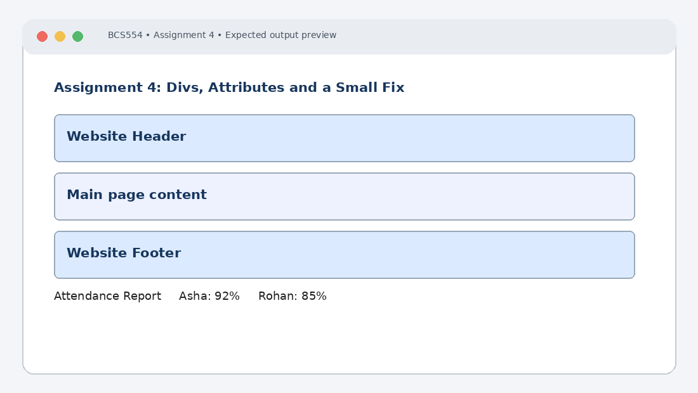

# Experiment No. 4: Divs, Attributes and a Small Fix

| Field | Detail |
| :--- | :--- |
| **Student Name** | Tanishk Jaiswal |
| **Roll Number** | 2410303504 |
| **Course / Branch** | B.Tech CSE – Third Year |
| **Subject** | BCS554 – HTML & CSS Development Lab |
| **Academic Session** | 2026–2027 |
| **Institution** | Invertis University, Bareilly |

---

## 1. Aim
Group parts of a page with div elements, add a data attribute, and fix errors in a broken page.

---

## 2. Software / Tools Required
Computer/Laptop, Visual Studio Code or any text editor, web browser (Chrome/Edge/Firefox), HTML5, CSS3.

---

## 3. Theory
The div element is a generic block-level container used to group content. The class attribute can be shared by multiple elements, while an id should uniquely identify an element in a page. Custom data-* attributes store extra information in HTML.

---

## 4. Algorithm / Procedure
1. Create layout.html with three div blocks whose classes are header, main and footer, in that order.
2. Create attributes.html with a div whose id is profile and a paragraph inside it with data-topic="hobbies".
3. Correct the missing closing tags in the supplied broken attendance page and save the corrected file as attendance-fixed.html.

---

## 5. Program / Queries / Commands

### Task 1 – layout.html
```html
<!DOCTYPE html>
<html lang="en">
<head><meta charset="UTF-8"><title>Layout</title></head>
<body>
 <div class="header">Website Header</div>
 <div class="main">Main page content</div>
 <div class="footer">Website Footer</div>
</body>
</html>
```

### Task 2 – attributes.html
```html
<!DOCTYPE html>
<html lang="en">
<head><meta charset="UTF-8"><title>Attributes</title></head>
<body>
 <div id="profile">
 <p data-topic="hobbies">I enjoy reading and playing sports.</p>
 </div>
</body>
</html>
```

### Task 3 – attendance-fixed.html
```html
<!DOCTYPE html>
<html lang="en">
<head>
 <meta charset="UTF-8">
 <title>Attendance</title>
</head>
<body>
 <h1>Attendance Report</h1>
 <p>Asha: 92%</p>
 <p>Rohan: 85%</p>
</body>
</html>
```

---

## 6. Input
Use the sample text and values specified in the tasks above. For personal details and image filenames, substitute your own values or the instructor-provided filename.

---

## 7. Output Description
Browser output: three blocks appear in header/main/footer order. The profile paragraph is visible while data-topic is not displayed. The corrected attendance page shows Attendance Report, Asha: 92% and Rohan: 85%.

---

## 8. Output Screenshot


---

## 9. Result
The experiment was completed according to the stated aim. Browser output: three blocks appear in header/main/footer order. The profile paragraph is visible while data-topic is not displayed. The corrected attendance page shows Attendance Report, Asha: 92% and Rohan: 85%.

---

## 10. Viva-Voce Questions & Answers
**Q: What is a div element?**

> **Answer:** The `<div>` tag is a non-semantic generic block-level container element used to group HTML elements together for styling (with CSS) or document manipulation (with JavaScript).

**Q: Differentiate class and id.**

> **Answer:** A `class` attribute can be assigned to multiple elements across a page and styled using the `.classname` selector, whereas an `id` must be unique to a single element within the HTML document and styled using `#idname`.

**Q: What is a data-* attribute?**

> **Answer:** `data-*` attributes allow developers to embed custom private data attributes on any HTML element, which can later be accessed via CSS or JavaScript (`dataset` API) without violating HTML specifications.

**Q: Why should HTML tags be properly closed?**

> **Answer:** Properly closing HTML tags ensures valid DOM tree structure, prevents unexpected rendering bugs across different browsers, maintains layout integrity, and aids screen readers and search engines.

