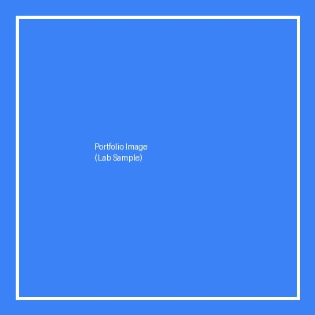
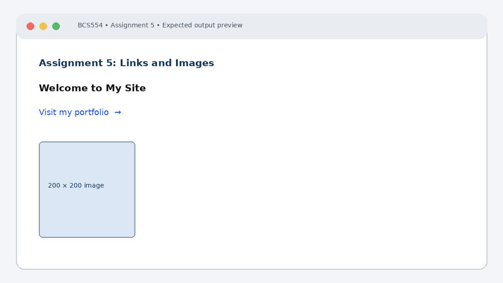

# Experiment No. 5: Links and Images

| Field | Detail |
| :--- | :--- |
| **Student Name** | Tanishk Jaiswal |
| **Roll Number** | 2410303504 |
| **Course / Branch** | B.Tech CSE – Third Year |
| **Subject** | BCS554 – HTML & CSS Development Lab |
| **Academic Session** | 2026–2027 |
| **Institution** | Invertis University, Bareilly |

---

## 1. Aim
Link two pages together and add a picture with alt text.

---

## 2. Software / Tools Required
Computer/Laptop, Visual Studio Code or any text editor, web browser (Chrome/Edge/Firefox), HTML5, CSS3.

---

## 3. Theory
The anchor element creates hyperlinks using href. Relative URLs can link files in the same project. The img element embeds an image; alt provides a text alternative if the image cannot be displayed and improves accessibility.

---

## 4. Algorithm / Procedure
1. Create home.html with heading Welcome to My Site and a link labelled portfolio to portfolio.html.
2. Create portfolio.html with a heading and a link back to home.html.
3. Create portfolio-image.html with a heading and an image from the images folder. Set width and height to 200 and provide descriptive alt text. Replace your-image.jpg with the filename given by your instructor.

---

## 5. Program / Queries / Commands

### Task 1 – home.html
```html
<!DOCTYPE html>
<html lang="en">
<head><meta charset="UTF-8"><title>Home</title></head>
<body>
 <h1>Welcome to My Site</h1>
 <p>Visit my <a href="portfolio.html">portfolio</a>.</p>
</body>
</html>
```

### Task 2 – portfolio.html
```html
<!DOCTYPE html>
<html lang="en">
<head><meta charset="UTF-8"><title>Portfolio</title></head>
<body>
 <h1>My Portfolio</h1>
 <a href="home.html">Back to Home</a>
</body>
</html>
```

### Task 3 – portfolio-image.html
```html
<!DOCTYPE html>
<html lang="en">
<head><meta charset="UTF-8"><title>Portfolio Image</title></head>
<body>
 <h1>My Picture</h1>
 
</body>
</html>
```

---

## 6. Input
Use the sample text and values specified in the tasks above. For personal details and image filenames, substitute your own values or the instructor-provided filename.

---

## 7. Output Description
Browser output: clicking portfolio opens portfolio.html; the back link returns home. The image appears at 200 × 200 pixels. If it is missing, its alt text is displayed.

---

## 8. Output Screenshot


---

## 9. Result
The experiment was completed according to the stated aim. Browser output: clicking portfolio opens portfolio.html; the back link returns home. The image appears at 200 × 200 pixels. If it is missing, its alt text is displayed.

---

## 10. Viva-Voce Questions & Answers
**Q: Which element creates a hyperlink?**

> **Answer:** The `<a>` (anchor) tag creates hyperlinks in HTML, using the `href` attribute to specify the destination URL.

**Q: What is a relative URL?**

> **Answer:** A relative URL points to a file within the same website/directory structure relative to the current file (e.g. `portfolio.html` or `images/pic.jpg`), without specifying the full protocol and domain name.

**Q: Why is alt text important?**

> **Answer:** The `alt` attribute provides accessible alternative text for visually impaired users using screen readers, helps search engine image indexing, and displays text in place of an image if it fails to load.

**Q: Which attributes specify image dimensions?**

> **Answer:** The `width` and `height` attributes on the `` tag specify image dimensions in pixels, or CSS properties `width` and `height` can be used.

