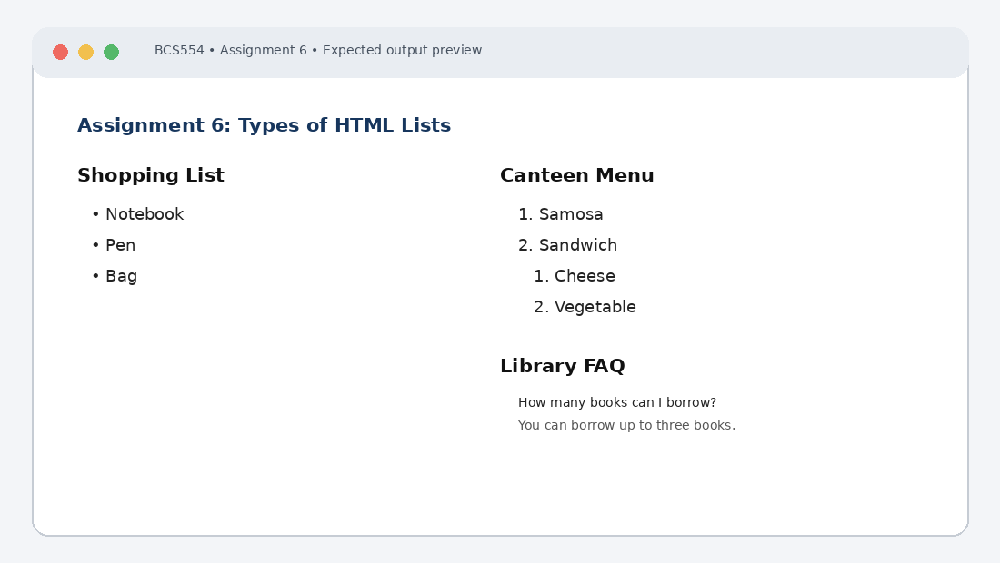

# Experiment No. 6: Types of HTML Lists

| Field | Detail |
| :--- | :--- |
| **Student Name** | Tanishk Jaiswal |
| **Roll Number** | 2410303504 |
| **Course / Branch** | B.Tech CSE – Third Year |
| **Subject** | BCS554 – HTML & CSS Development Lab |
| **Academic Session** | 2026–2027 |
| **Institution** | Invertis University, Bareilly |

---

## 1. Aim
Make a bulleted list, a numbered list with a nested list, and a description list.

---

## 2. Software / Tools Required
Computer/Laptop, Visual Studio Code or any text editor, web browser (Chrome/Edge/Firefox), HTML5, CSS3.

---

## 3. Theory
An unordered list uses ul and li for bullet points. An ordered list uses ol and li for numbered items. A nested list is placed inside a list item. A description list uses dl, dt for a term and dd for its description.

---

## 4. Algorithm / Procedure
1. Create shopping-list.html with heading Shopping List and an unordered list of Notebook, Pen and Bag.
2. Create canteen-menu.html with an ordered list of Samosa and Sandwich. Under Sandwich, add a nested ordered list of Cheese and Vegetable.
3. Create faq.html with the two questions from the brief in dt elements and an answer for each in dd elements.

---

## 5. Program / Queries / Commands

### Task 1 – shopping-list.html
```html
<!DOCTYPE html>
<html lang="en">
<head><meta charset="UTF-8"><title>Shopping List</title></head>
<body>
 <h1>Shopping List</h1>
 <ul><li>Notebook</li><li>Pen</li><li>Bag</li></ul>
</body>
</html>
```

### Task 2 – canteen-menu.html
```html
<!DOCTYPE html>
<html lang="en">
<head><meta charset="UTF-8"><title>Canteen Menu</title></head>
<body>
 <h1>Canteen Menu</h1>
 <ol>
 <li>Samosa</li>
 <li>Sandwich
 <ol><li>Cheese</li><li>Vegetable</li></ol>
 </li>
 </ol>
</body>
</html>
```

### Task 3 – faq.html
```html
<!DOCTYPE html>
<html lang="en">
<head><meta charset="UTF-8"><title>Library FAQ</title></head>
<body>
 <h1>Library FAQ</h1>
 <dl>
 <dt>How many books can I borrow?</dt>
 <dd>You can borrow up to three books.</dd>
 <dt>Is the library open on Sunday?</dt>
 <dd>No, the library remains closed on Sunday.</dd>
 </dl>
</body>
</html>
```

---

## 6. Input
Use the sample text and values specified in the tasks above. For personal details and image filenames, substitute your own values or the instructor-provided filename.

---

## 7. Output Description
Browser output: three bullet points; a numbered list with a nested numbered list under Sandwich; and two FAQ questions, each followed by its answer.

---

## 8. Output Screenshot


---

## 9. Result
The experiment was completed according to the stated aim. Browser output: three bullet points; a numbered list with a nested numbered list under Sandwich; and two FAQ questions, each followed by its answer.

---

## 10. Viva-Voce Questions & Answers
**Q: What is the difference between ul and ol?**

> **Answer:** `<ul>` renders an unordered bulleted list where order does not matter, whereas `<ol>` renders a numbered or sequentially ordered list.

**Q: Which element represents a list item?**

> **Answer:** The `<li>` (list item) tag is used to define items inside both ordered (`<ol>`) and unordered (`<ul>`) lists.

**Q: What is a nested list?**

> **Answer:** A nested list is a list placed directly inside a list item (`<li>`) of another list to create hierarchical sub-categories.

**Q: What are dt and dd used for?**

> **Answer:** Inside a description list (`<dl>`), `<dt>` defines a description term or question, while `<dd>` defines the description, definition, or answer associated with that term.

