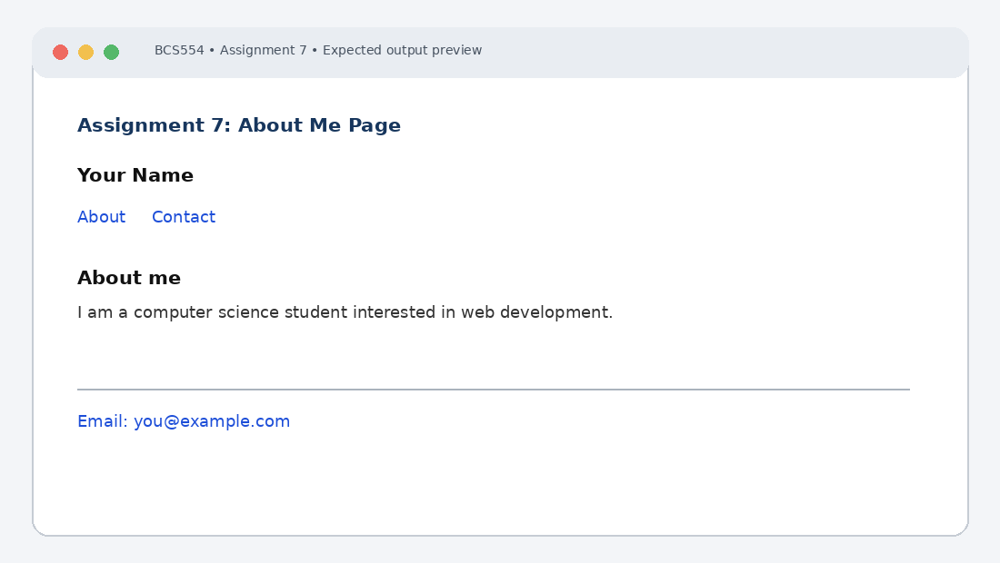

# Experiment No. 7: About Me Page

| Field | Detail |
| :--- | :--- |
| **Student Name** | Tanishk Jaiswal |
| **Roll Number** | 2410303504 |
| **Course / Branch** | B.Tech CSE – Third Year |
| **Subject** | BCS554 – HTML & CSS Development Lab |
| **Academic Session** | 2026–2027 |
| **Institution** | Invertis University, Bareilly |

---

## 1. Aim
Build a short About Me page with semantic tags, an about section and a contact link.

---

## 2. Software / Tools Required
Computer/Laptop, Visual Studio Code or any text editor, web browser (Chrome/Edge/Firefox), HTML5, CSS3.

---

## 3. Theory
Semantic HTML elements describe the meaning of page regions. header contains introductory content, nav contains navigation links, main contains primary content, section groups related content and footer contains closing information. A mailto link opens the configured email application.

---

## 4. Algorithm / Procedure
1. Create about-me.html with a header containing your name in h1 and nav links About (#about) and Contact (#contact). Include an empty main and footer.
2. Add a section with id about inside main, an h2 titled About me and a paragraph about yourself.
3. Add a paragraph inside the footer with a mailto link to your email address, and give the footer id contact.

---

## 5. Program / Queries / Commands

### Task 1 – about-me.html (structure)
```html
<!DOCTYPE html>
<html lang="en">
<head><meta charset="UTF-8"><title>About Me</title></head>
<body>
 <header>
 <h1>Tanishk Jaiswal</h1>
 <nav>
 <a href="#about">About</a>
 <a href="#contact">Contact</a>
 </nav>
 </header>
 <main></main>
 <footer></footer>
</body>
</html>
```

### Task 2 – add inside main
```html
<section id="about">
 <h2>About me</h2>
 <p>I am a computer science student interested in web development.</p>
</section>
```

### Task 3 – replace the empty footer
```html
<footer id="contact">
 <p>Email:
 <a href="mailto:jtanishk121@gmail.com">jtanishk121@gmail.com</a>
 </p>
</footer>
```

---

## 6. Input
Use the sample text and values specified in the tasks above. For personal details and image filenames, substitute your own values or the instructor-provided filename.

---

## 7. Output Description
Browser output: your name appears at the top with About and Contact links. The About me section appears in the main area. The footer contains a clickable email address; Contact jumps to the footer.

---

## 8. Output Screenshot


---

## 9. Result
The experiment was completed according to the stated aim. Browser output: your name appears at the top with About and Contact links. The About me section appears in the main area. The footer contains a clickable email address; Contact jumps to the footer.

---

## 10. Viva-Voce Questions & Answers
**Q: What is semantic HTML?**

> **Answer:** Semantic HTML uses tags that convey the meaning and purpose of elements to both the browser and developer (such as `<header>`, `<nav>`, `<main>`, `<article>`, `<section>`, and `<footer>`), rather than non-semantic generic containers like `<div>` and `<span>`.

**Q: What is the purpose of nav?**

> **Answer:** The `<nav>` element represents a section of a page whose purpose is to provide navigation links, either within the current document or to other documents.

**Q: How does an in-page anchor work?**

> **Answer:** An in-page anchor links to a specific section on the same page by referencing an element's unique `id` with a hash symbol in the `href` attribute (e.g. `<a href="#contact">` jumps to `<footer id="contact">`).

**Q: What does mailto do?**

> **Answer:** The `mailto:` URL scheme creates a hyperlink that instructs the browser to open the user's default email client pre-addressed to the recipient's email address.

