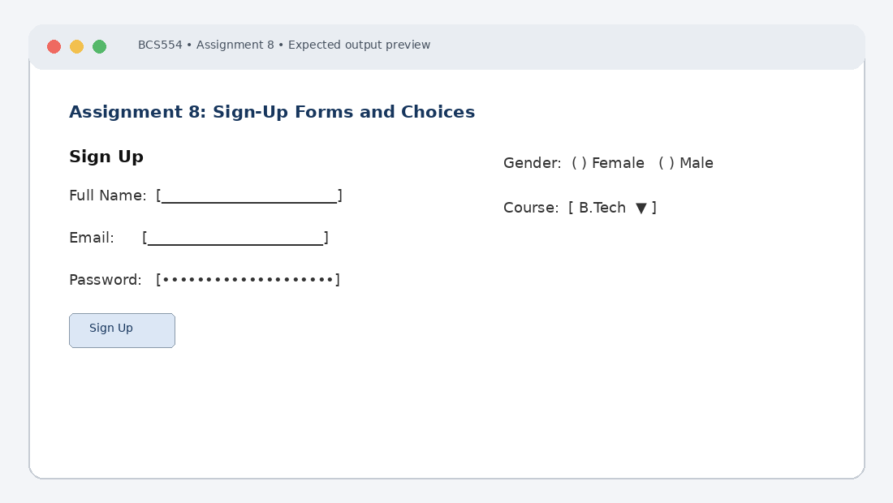

# Experiment No. 8: Sign-Up Forms and Choices

| Field | Detail |
| :--- | :--- |
| **Student Name** | Tanishk Jaiswal |
| **Roll Number** | 2410303504 |
| **Course / Branch** | B.Tech CSE – Third Year |
| **Subject** | BCS554 – HTML & CSS Development Lab |
| **Academic Session** | 2026–2027 |
| **Institution** | Invertis University, Bareilly |

---

## 1. Aim
Make a labelled form with text, email and password fields, choices and a submit button.

---

## 2. Software / Tools Required
Computer/Laptop, Visual Studio Code or any text editor, web browser (Chrome/Edge/Firefox), HTML5, CSS3.

---

## 3. Theory
The form element groups controls for user input. Labels should be associated with controls using for and id. Input types such as text, email and password provide suitable input behaviour. Radio buttons sharing a name form a single-choice group; select and option create a dropdown. required enables browser validation.

---

## 4. Algorithm / Procedure
1. Create signup.html with method="post" and action="thanks.html". Add linked labels and fields for full name, email and password.
2. Create choices.html with Female and Male radio buttons sharing the same name, and a course dropdown with BCA and B.Tech.
3. Create signup-required.html with required full name and email fields, a placeholder on the name field and a Submit button.

---

## 5. Program / Queries / Commands

### Task 1 – signup.html
```html
<!DOCTYPE html>
<html lang="en">
<head><meta charset="UTF-8"><title>Sign Up</title></head>
<body>
 <h1>Sign Up</h1>
 <form method="post" action="thanks.html">
 <label for="full-name">Full Name:</label>
 <input type="text" id="full-name" name="fullName"><br><br>
 <label for="email">Email:</label>
 <input type="email" id="email" name="email"><br><br>
 <label for="password">Password:</label>
 <input type="password" id="password" name="password"><br><br>
 <button type="submit">Sign Up</button>
 </form>
</body>
</html>
```

### Task 2 – choices.html
```html
<!DOCTYPE html>
<html lang="en">
<head><meta charset="UTF-8"><title>Choices</title></head>
<body>
 <h1>Student Choices</h1>
 <form>
 <p>Gender:</p>
 <input type="radio" id="female" name="gender" value="Female">
 <label for="female">Female</label>
 <input type="radio" id="male" name="gender" value="Male">
 <label for="male">Male</label>
 <p><label for="course">Course:</label>
 <select id="course" name="course">
 <option>BCA</option><option>B.Tech</option>
 </select>
 </p>
 </form>
</body>
</html>
```

### Task 3 – signup-required.html
```html
<!DOCTYPE html>
<html lang="en">
<head><meta charset="UTF-8"><title>Required Form</title></head>
<body>
 <h1>Registration</h1>
 <form>
 <label for="name">Full Name:</label>
 <input type="text" id="name" name="name"
 placeholder="Enter your full name" required><br><br>
 <label for="mail">Email:</label>
 <input type="email" id="mail" name="email" required><br><br>
 <button type="submit">Submit</button>
 </form>
</body>
</html>
```

---

## 6. Input
Use the sample text and values specified in the tasks above. For personal details and image filenames, substitute your own values or the instructor-provided filename.

---

## 7. Output Description
Browser output: three labelled fields are shown and password characters are hidden. Only one gender radio button can be selected. The course dropdown shows BCA and B.Tech. Submitting empty required fields displays browser validation.

---

## 8. Output Screenshot


---

## 9. Result
The experiment was completed according to the stated aim. Browser output: three labelled fields are shown and password characters are hidden. Only one gender radio button can be selected. The course dropdown shows BCA and B.Tech. Submitting empty required fields displays browser validation.

---

## 10. Viva-Voce Questions & Answers
**Q: Why is a label associated with an input?**

> **Answer:** Associating `<label>` with an `<input>` via `for` and `id` improves accessibility for screen readers and allows users to click the label text to focus or toggle the input control.

**Q: What is the difference between radio and checkbox?**

> **Answer:** Radio buttons (`type="radio"`) sharing the same `name` attribute allow mutually exclusive selection of only one option, whereas checkboxes (`type="checkbox"`) allow independent selection of multiple options.

**Q: What does type=email do?**

> **Answer:** The `type="email"` input verifies syntactic email address formatting in compliant browsers and brings up an email-optimized keyboard on mobile devices.

**Q: What is the purpose of required?**

> **Answer:** The `required` boolean attribute ensures that an input field cannot be left blank upon form submission, triggering standard native browser validation messages.

