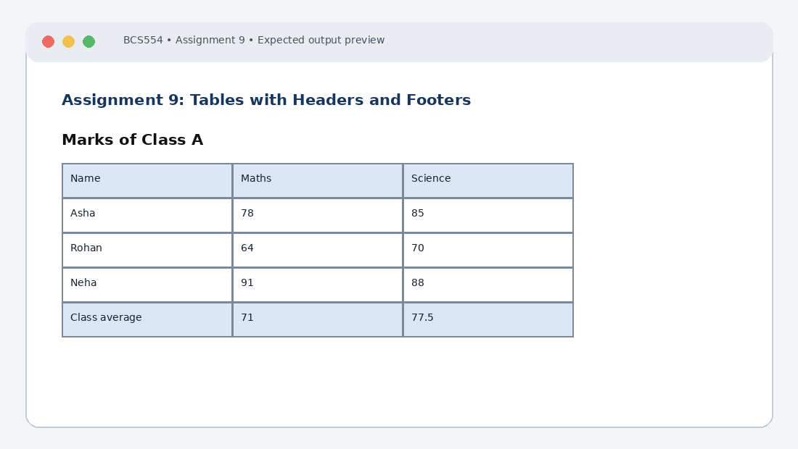

# Experiment No. 9: Tables with Headers and Footers

| Field | Detail |
| :--- | :--- |
| **Student Name** | Tanishk Jaiswal |
| **Roll Number** | 2410303504 |
| **Course / Branch** | B.Tech CSE – Third Year |
| **Subject** | BCS554 – HTML & CSS Development Lab |
| **Academic Session** | 2026–2027 |
| **Institution** | Invertis University, Bareilly |

---

## 1. Aim
Build a table with a caption, a header, rows and a footer, and add scope attributes.

---

## 2. Software / Tools Required
Computer/Laptop, Visual Studio Code or any text editor, web browser (Chrome/Edge/Firefox), HTML5, CSS3.

---

## 3. Theory
The table element represents tabular data. caption describes the table, thead groups heading rows, tbody groups data rows and tfoot groups summary rows. th represents a header cell and td a data cell. scope helps assistive technologies understand header relationships.

---

## 4. Algorithm / Procedure
1. Create marks.html with caption Marks of Class A, a thead row Name/Maths/Science and tbody rows Asha 78/85, Rohan 64/70 and Neha 91/88.
2. Create marks-average.html with the same caption and header, only Asha and Rohan rows, and a tfoot row Class average. Maths average = 71; Science average = 77.5.
3. Create marks-accessible.html with Asha and Rohan rows and no footer. Add scope="col" to each header cell and scope="row" to each name cell.

---

## 5. Program / Queries / Commands

### Task 1 – marks.html
```html
<!DOCTYPE html>
<html lang="en">
<head><meta charset="UTF-8"><title>Marks</title></head>
<body>
<table border="1">
 <caption>Marks of Class A</caption>
 <thead><tr><th>Name</th><th>Maths</th><th>Science</th></tr></thead>
 <tbody>
 <tr><td>Asha</td><td>78</td><td>85</td></tr>
 <tr><td>Rohan</td><td>64</td><td>70</td></tr>
 <tr><td>Neha</td><td>91</td><td>88</td></tr>
 </tbody>
</table>
</body>
</html>
```

### Task 2 – marks-average.html
```html
<!DOCTYPE html>
<html lang="en">
<head><meta charset="UTF-8"><title>Marks Average</title></head>
<body>
<table border="1">
 <caption>Marks of Class A</caption>
 <thead><tr><th>Name</th><th>Maths</th><th>Science</th></tr></thead>
 <tbody>
 <tr><td>Asha</td><td>78</td><td>85</td></tr>
 <tr><td>Rohan</td><td>64</td><td>70</td></tr>
 </tbody>
 <tfoot><tr><th>Class average</th><td>71</td><td>77.5</td></tr></tfoot>
</table>
</body>
</html>
```

### Task 3 – marks-accessible.html
```html
<!DOCTYPE html>
<html lang="en">
<head><meta charset="UTF-8"><title>Accessible Marks</title></head>
<body>
<table border="1">
 <caption>Marks of Class A</caption>
 <thead><tr><th scope="col">Name</th><th scope="col">Maths</th>
 <th scope="col">Science</th></tr></thead>
 <tbody>
 <tr><th scope="row">Asha</th><td>78</td><td>85</td></tr>
 <tr><th scope="row">Rohan</th><td>64</td><td>70</td></tr>
 </tbody>
</table>
</body>
</html>
```

---

## 6. Input
Use the sample text and values specified in the tasks above. For personal details and image filenames, substitute your own values or the instructor-provided filename.

---

## 7. Output Description
Browser output: the first table shows three students. The second footer displays averages 71 and 77.5. The third table looks similar but its column and row headers carry the requested scope attributes.

---

## 8. Output Screenshot


---

## 9. Result
The experiment was completed according to the stated aim. Browser output: the first table shows three students. The second footer displays averages 71 and 77.5. The third table looks similar but its column and row headers carry the requested scope attributes.

---

## 10. Viva-Voce Questions & Answers
**Q: What is the purpose of caption?**

> **Answer:** The `<caption>` tag defines the title or summary description of the table and is positioned immediately following the opening `<table>` tag for accessibility.

**Q: Differentiate thead, tbody and tfoot.**

> **Answer:** `<thead>` groups header rows, `<tbody>` encapsulates the primary data rows, and `<tfoot>` defines the footer or summary row (such as totals or averages).

**Q: What is the difference between th and td?**

> **Answer:** `<th>` represents a header cell (rendered bold and centered by default) while `<td>` denotes a standard data cell (regular text aligned to the left).

**Q: Why are scope attributes used?**

> **Answer:** The `scope` attribute (`scope="col"` or `scope="row"`) explicitly establishes semantic associations between header cells and related columns or rows, critical for screen readers used by visually impaired individuals.

